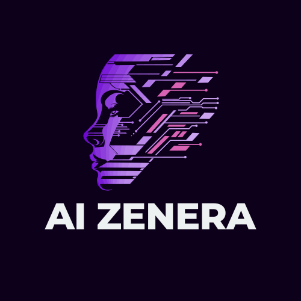

# AIZenera — AI Education Platform for Engineers

<div align="center">



**AI Education for Engineers | Courses · Tools · Community**

[](https://react.dev/)
[](https://www.typescriptlang.org/)
[](https://vitejs.dev/)
[](https://tailwindcss.com/)
[](https://firebase.google.com/)

</div>

---

## 📖 Table of Contents

- [About AIZenera](#about-aizenera)
- [Live Site](#live-site)
- [Features Overview](#features-overview)
- [Pages & Sections](#pages--sections)
- [Tech Stack](#tech-stack)
- [Project Structure](#project-structure)
- [Getting Started](#getting-started)
- [Environment Variables](#environment-variables)
- [Design System](#design-system)
- [Animation Libraries](#animation-libraries)
- [Firebase Integration](#firebase-integration)
- [Deployment](#deployment)
- [Contributing](#contributing)

---

## 🚀 About AIZenera

**AIZenera** is a bootstrapped AI education platform for engineering students across India. Founded by engineers from IEM Kolkata, the platform bridges the gap between academic knowledge and industry-ready skills through **live cohort-based courses**, **free AI-powered tools**, a **campus ambassador programme**, and an active student community.

> *"Making AI education accessible to every aspiring engineer, regardless of their background."*

### Key Stats
| Metric | Value |
|--------|-------|
| Active Learners | 1,000+ |
| Partner Clubs | 15+ |
| Courses Delivered | 3+ |
| Average Course Rating | 4.8 / 5 |
| Projects Completed | 300+ |

---

## 🌐 Live Site

The platform runs locally as a Vite dev server:

```
http://localhost:8080
```

---

## ✨ Features Overview

| Feature | Description |
|---------|-------------|
| 🎓 **Course Academy** | Cohort-based live AI courses with registration, status tracking, and pricing |
| 🛠️ **AI Tools Hub** | AI-powered resume analyser, interview practice, GPA calculator, and more |
| 🧑‍🎓 **GPA Calculator** | Semester GPA/CGPA calculator supporting Indian university grade scales |
| 📢 **Campus Ambassadors** | Tiered ambassador programme (Bronze / Silver / Gold) with perks & leaderboard |
| 📰 **Newsroom** | Latest updates and news from the AIZenera community |
| 📋 **Notice Board** | Important announcements for learners |
| 👤 **User Profile** | Editable user profile backed by Firebase Firestore with anonymous auth |
| 📚 **Study Material** | Curated free resources and study materials |
| 📬 **Contact Page** | Email-based contact form powered by EmailJS |
| 🔒 **Privacy Policy & Terms** | Full legal pages |
| 🌐 **Social Links** | WhatsApp community, Instagram, LinkedIn, and YouTube integrations |
| 🏫 **Partner Logos Carousel** | Auto-scrolling showcase of 8+ partner institutions |
| 💬 **Testimonials Slider** | Swiper.js powered review carousel |
| 🎥 **3D Scene** | Interactive Three.js wireframe sphere background in the hero |

---

## 📄 Pages & Sections

### 1. 🏠 Home (`/`)
The main landing page. Composed of the following sections:

#### Hero Section
- Animated gradient headline with parallax scroll effect (`framer-motion` `useScroll` + `useTransform`)
- Dynamic animated gradient **orbs** (indigo, pink, cyan) floating in the background
- Personalized greeting using `useUser` context (e.g., *"Welcome back, [Name]"*)
- Three.js **3D animated scene** (wireframe sphere) embedded as the background
- Primary CTA: **"Explore Courses"** → `/courses`
- Secondary CTA: **"Join WhatsApp Community"** (opens external link)

#### Stats Bar
Three glassmorphism stat cards displaying:
- **1,000+ Active Learners** (indigo)
- **15+ Partner Clubs** (cyan)
- **4.8/5 Course Rating** (pink)

#### WhatsApp Community CTA
- Gradient card with a direct WhatsApp group join link
- Animated glow pulse effect on the button

#### Featured Courses Section
Three highlighted course cards:
| Course | Price | Status |
|--------|-------|--------|
| Figma & Framer Masterclass | ₹99 | 🔴 LIVE |
| GenAI Masterclass | ₹149 | Completed |
| LLMs Masterclass | ₹99 | Completed |

Each card shows: course image, title, status badge, price, dates, and a CTA button.

#### Social Media Links
Four animated social cards linking to:
- **WhatsApp** community group
- **Instagram** `@aizenera_official`
- **LinkedIn** company page
- **YouTube** channel `@aizenera2025`

#### Partner Logos Ticker
Auto-scrolling infinite carousel of 8 partner institution logos (CSS animation).

#### Testimonials Slider
Swiper.js carousel featuring 3 student testimonials with:
- Avatar images, name, role, and quote
- Autoplay with loop, pagination dots, and navigation arrows

#### Footer
- Column links to all site pages
- Social icons (WhatsApp, Instagram, LinkedIn, YouTube)
- Copyright notice
- Email newsletter subscribe input

---

### 2. 🎓 Courses (`/courses`)
Full academy listing page with detailed course cards.

**Courses Listed:**
| # | Title | Duration | Price | Status |
|---|-------|----------|-------|--------|
| 1 | Figma & Framer Masterclass | 2 Days | ₹99 | 🔴 Live |
| 2 | LLM Masterclass | 3 Days | ₹99 | Completed |
| 3 | GenAI Masterclass | 30 Days | ₹149 | Completed |

**Each course card displays:**
- Live/Completed status badge + header bar
- Title, description, duration, dates, enrolled count, star rating
- Topic tags (e.g., LLM Fundamentals, Prompt Engineering, RAG Systems)
- **"Enroll Now"** button (links to Google Form for live courses)

**Custom Training Section:**
A black CTA card inviting universities and organisations to request custom AI curriculum.

---

### 3. 🛠️ Tools (`/tools`)
AI-powered tools hub in a 3-column grid.

| Tool | Status | Features |
|------|--------|---------|
| Resume Analyzer | ✅ Available | ATS Score, Keyword Suggestions, Format Check |
| AI Interview Practice | ✅ Available | Mock Interviews, Response Analysis ([recruitix-eight.vercel.app](https://recruitix-eight.vercel.app/)) |
| GPA Calculator | ✅ Available | Semester GPA, CGPA, Export Results |
| AI Code Assistant | 🔜 Coming Soon | Code Review, Bug Detection, Multi-Language |
| AI Study Planner | 🔜 Coming Soon | Custom Plans, Adaptive Learning |
| Project Idea Generator | 🔜 Coming Soon | Skill-Based Ideas, Team Matching |

A **"Have a Tool Idea?"** suggestion card appears at the bottom.

---

### 4. 🧮 GPA Calculator (`/gpa-calculator`)
Interactive academic GPA calculator built entirely in-browser.

**Features:**
- Add / remove subjects dynamically
- Per-subject: name, credit hours (1–6), grade (O / E / A / B / C / D / F)
- Real-time GPA calculation with a colour-coded circular display
- Motivational message based on GPA (e.g., *"Outstanding! 🎉"* for ≥ 9.0)
- Grade scale reference card (sidebar)
- Reset button

**Grade Scale (Indian University Standard):**
| Grade | Points |
|-------|--------|
| O | 10 |
| E | 9 |
| A | 8 |
| B | 7 |
| C | 6 |
| D | 5 |
| F | 0 |

---

### 5. 🧑‍🤝‍🧑 Campus Ambassadors (`/ca-page`)
Programme page for the Campus Ambassador (CA) initiative.

**Sections:**
- **Hero** — Programme overview with "Become a CA" CTA (Google Form)
- **Why Become a CA?** — 4 benefit cards: Certificates, Skill Development, Exclusive Access, Network
- **Current Ambassadors** — Ambassador cards (Aditya Ghosh, Arnaab Chatterjee — IEM Kolkata) with tier badges
- **How It Works** — 4-step process: Apply → Kickoff → Engage → Earn
- **Responsibilities** — Listed duties for ambassadors
- **Rewards & Tiers** — Bronze / Silver / Gold tier perks breakdown
- **FAQs** — Eligibility, selection process, tier criteria
- **Apply CTA** — Direct link to application Google Form

---

### 6. ℹ️ About Us (`/about`)
Company story and team page.

**Sections:**
- **Founding Story** — Written by co-founders, explains mission and origin
- **Core Values** — Mission-Driven · Community First · Practical Learning · Quality Content
- **Leadership** — Founders section:
  - **Debangshu Chatterjee** — Co-founder
  - **Nirmalya Sengupta** — Co-Founder (30+ yrs AI/ML experience)
- **Our Story Timeline** — Milestones: July 2025 → Sept 2025 → Nov 2025
- **Team Overview** — Founders, Mentors, Community (1,000+ learners)
- **Impact Numbers** — 1,000+ Learners · 15+ Partner Clubs · 4.8/5 Rating · 300+ Projects

---

### 7. 👤 Edit Profile (`/profile`)
User profile editor backed by Firebase Firestore.

**Fields:**
- First Name, Last Name
- Email Address, Phone Number
- College/University, Course/Programme, Year of Study
- Bio / About
- Avatar (image upload, stored as base64 Data URL)

Profile data persists across sessions via Firebase anonymous auth + Firestore `profiles` collection.

---

### 8. 📚 Study Material (`/study-material`)
Curated free learning resources page for students.

---

### 9. 📰 Newsroom (`/newsroom`)
Latest news, blog posts, and updates from AIZenera.

---

### 10. 📋 Notice (`/notice`)
Important announcements and notices for the community.

---

### 11. 📬 Contact (`/contact`)
Contact form with EmailJS integration.

**Fields:** Name, Email, Subject, Message

---

### 12. 🔒 Privacy Policy (`/privacy-policy`)
Full privacy policy page.

---

### 13. 📜 Terms & Service (`/terms`)
Terms and conditions page.

---

### 14. ❌ 404 Not Found (`/*`)
Custom 404 error page for unmatched routes.

---

## 🧩 Tech Stack

### Core Framework
| Library | Version | Purpose |
|---------|---------|---------|
| React | 18.3.1 | UI framework |
| TypeScript | 5.8 | Type safety |
| Vite | 5.4 | Build tool & dev server |
| React Router DOM | 6.30 | Client-side routing |

### Styling
| Library | Version | Purpose |
|---------|---------|---------|
| Tailwind CSS | 3.4 | Utility-first CSS |
| tailwindcss-animate | 1.0.7 | Animation utilities |
| class-variance-authority | 0.7 | Component variant management |
| clsx + tailwind-merge | latest | Conditional class merging |

### UI Components
| Library | Purpose |
|---------|---------|
| Radix UI (full suite) | Accessible headless primitives (Dialog, Select, Tooltip, etc.) |
| Lucide React | Icon library |
| Shadcn/UI pattern | Component wrapper layer over Radix |
| Embla Carousel | Native carousel engine |
| Swiper.js | Feature-rich testimonials slider |

### Animation
| Library | Version | Purpose |
|---------|---------|---------|
| Framer Motion | 12.38 | Page transitions, scroll effects, entrance animations |
| GSAP | 3.14 | High-performance timeline animations |
| Theatre.js (`@theatre/core`, `@theatre/studio`) | 0.7 | Motion design & keyframe editor |

### 3D Graphics
| Library | Version | Purpose |
|---------|---------|---------|
| Three.js | 0.183 | 3D rendering engine |
| @react-three/fiber | 8.17 | React renderer for Three.js |
| @react-three/drei | 9.121 | Three.js helpers & utilities |

### Backend / Database
| Service | SDK | Purpose |
|---------|-----|---------|
| Firebase Auth | 12.6 | Anonymous authentication |
| Firebase Firestore | 12.6 | User profile persistence |
| EmailJS | 4.4 | Contact form email delivery |

### Data & State
| Library | Purpose |
|---------|---------|
| TanStack React Query | Server state, caching |
| React Hook Form + Zod | Form validation |
| React Context (UserContext) | Global user state |

---

## 📁 Project Structure

```
AIZenera-LLP/
├── public/                    # Static assets
├── src/
│   ├── assets/                # Images, logos, course banners
│   │   ├── aizenera-logo.png
│   │   ├── 1.png – 11.png     # Hero & partner logos
│   │   └── my pic.jpg         # Founder photo
│   │
│   ├── components/
│   │   ├── Layout.tsx         # App shell wrapping sidebar + main
│   │   ├── Sidebar.tsx        # Navigation sidebar (glassmorphism)
│   │   ├── Scene3D.tsx        # Three.js animated sphere background
│   │   └── ui/                # Shadcn/Radix UI component library
│   │       ├── button.tsx
│   │       ├── card.tsx
│   │       ├── badge.tsx
│   │       ├── input.tsx
│   │       ├── select.tsx
│   │       ├── toast.tsx
│   │       └── ...40+ components
│   │
│   ├── context/
│   │   └── UserContext.tsx     # Firebase auth + Firestore profile state
│   │
│   ├── hooks/                 # Custom React hooks
│   │
│   ├── lib/
│   │   ├── firebase.ts        # Firebase app + auth + db initialisation
│   │   └── utils.ts           # cn() utility
│   │
│   ├── pages/
│   │   ├── Home.tsx           # Landing page (hero, stats, courses, socials)
│   │   ├── Courses.tsx        # Course academy listing
│   │   ├── Tools.tsx          # AI tools hub
│   │   ├── GPACalculator.tsx  # Interactive GPA calculator
│   │   ├── CAPage.tsx         # Campus Ambassador programme
│   │   ├── AboutUs.tsx        # Company story & team
│   │   ├── Profile.tsx        # User profile editor
│   │   ├── StudyMaterial.tsx  # Study resources
│   │   ├── Newsroom.tsx       # News & updates
│   │   ├── Notice.tsx         # Announcements
│   │   ├── Contact.tsx        # Contact form (EmailJS)
│   │   ├── PrivacyPolicy.tsx  # Legal — Privacy
│   │   ├── Terms.tsx          # Legal — Terms
│   │   └── NotFound.tsx       # 404 page
│   │
│   ├── App.tsx                # Root router & provider setup
│   ├── main.tsx               # React DOM entry point
│   ├── index.css              # Global styles + design tokens
│   └── vite-env.d.ts
│
├── tailwind.config.ts         # Tailwind theme + custom tokens
├── vite.config.ts             # Vite + React SWC config
├── tsconfig.json
├── package.json
├── EMAIL_SETUP.md             # EmailJS configuration guide
└── README.md                  # This file
```

---

## 🚀 Getting Started

### Prerequisites
- **Node.js** ≥ 18.x
- **npm** ≥ 9.x

### Installation

```bash
# 1. Clone the repository
git clone https://github.com/your-org/aizenera-llp.git
cd aizenera-llp/AIZenera-LLP

# 2. Install dependencies
npm install

# 3. Set up environment variables (see below)
cp .env.example .env

# 4. Start the development server
npm run dev
```

The app will be available at `http://localhost:8080`.

### Build for Production

```bash
npm run build
```

### Preview Production Build

```bash
npm run preview
```

---

## 🔑 Environment Variables

Create a `.env` file in `AIZenera-LLP/` with the following values:

```env
# Firebase Configuration
VITE_FIREBASE_API_KEY=your_api_key
VITE_FIREBASE_AUTH_DOMAIN=your_project.firebaseapp.com
VITE_FIREBASE_PROJECT_ID=your_project_id
VITE_FIREBASE_STORAGE_BUCKET=your_project.appspot.com
VITE_FIREBASE_MESSAGING_SENDER_ID=your_sender_id
VITE_FIREBASE_APP_ID=your_app_id

# EmailJS (for Contact form)
VITE_EMAILJS_SERVICE_ID=your_service_id
VITE_EMAILJS_TEMPLATE_ID=your_template_id
VITE_EMAILJS_PUBLIC_KEY=your_public_key
```

> See `EMAIL_SETUP.md` for detailed EmailJS configuration steps.

---

## 🎨 Design System

AIZenera uses a **Deep Space Dark Theme** with a **Glassmorphism** aesthetic.

### Color Palette

| Token | Value | Usage |
|-------|-------|-------|
| `--color-bg-deep` | `#050816` | Base page background |
| `--color-bg-surface` | `#0a0f1e` | Card surfaces |
| `--color-primary` | `#6366F1` (Indigo 500) | Primary accent, CTAs |
| `--color-secondary` | `#EC4899` (Pink 500) | Secondary accent |
| `--color-tertiary` | `#0EA5E9` (Cyan 500) | Tertiary highlights |
| `--color-text-primary` | `rgba(255,255,255,0.92)` | Body text |
| `--color-text-muted` | `rgba(255,255,255,0.45)` | Labels, descriptions |

### Typography

| Role | Font | Weight |
|------|------|--------|
| Display (headings) | **Outfit** | 600–900 |
| Body | **Inter** | 400–600 |

Both loaded via Google Fonts CDN.

### Glassmorphism Card

```css
.glass-card {
  background: rgba(255, 255, 255, 0.03);
  backdrop-filter: blur(20px);
  border: 1px solid rgba(255, 255, 255, 0.08);
  box-shadow: 0 8px 32px rgba(0, 0, 0, 0.4);
}
```

### CSS Custom Properties

All design tokens are defined as CSS variables in `src/index.css` under `:root`.

---

## 🎞️ Animation Libraries

| Library | Application |
|---------|------------|
| **Framer Motion** | Page entrance animations, hero parallax scroll, sidebar activeState indicator (`layoutId`), staggered card reveals |
| **GSAP** | High-performance scroll-triggered effects |
| **Theatre.js** | Advanced keyframe animation sequencing |
| **CSS Keyframes** | Infinite ticker, floating orbs, pulse-glow |
| **Swiper.js** | Testimonials carousel with autoplay + pagination |

### Example Framer Motion Usage

```tsx
// Staggered children animation
const containerVariants = {
  hidden: { opacity: 0 },
  visible: { opacity: 1, transition: { staggerChildren: 0.12 } },
};

const itemVariants = {
  hidden: { y: 32, opacity: 0 },
  visible: { y: 0, opacity: 1, transition: { duration: 0.6, ease: [0.22, 1, 0.36, 1] } },
};
```

---

## 🔥 Firebase Integration

### Authentication
- Uses **Firebase Anonymous Authentication** — users are automatically signed in anonymously on first visit.
- No login or sign-up required; identity is tied to the browser session.
- Auth state is managed via `onAuthStateChanged` inside `UserContext.tsx`.

### Firestore Database
- **Collection:** `profiles`
- **Document ID:** Firebase anonymous `uid`
- **Schema:**
  ```ts
  {
    firstName?: string
    lastName?: string
    email?: string
    phone?: string
    college?: string
    course?: string
    year?: string
    bio?: string
    avatarDataUrl?: string | null
  }
  ```
- Profile data is persisted with `setDoc(..., { merge: true })` on every change.

---

## 📦 Social Links & External Integrations

| Platform | Link |
|----------|------|
| WhatsApp Community | [Join Group](https://chat.whatsapp.com/IxavpJ0dP5O2DboZCNFtnk) |
| Instagram | [@aizenera_official](https://www.instagram.com/aizenera_official) |
| LinkedIn | [AIZenera Company Page](https://www.linkedin.com/company/aizenera/) |
| YouTube | [@aizenera2025](https://youtube.com/@aizenera2025) |
| AI Interview Tool | [recruitix-eight.vercel.app](https://recruitix-eight.vercel.app/) |
| CA Application Form | [Google Form](https://docs.google.com/forms/d/e/1FAIpQLSdufVtmGbbA8aEky---6U_SE9wLLlfxYmSuxdxqQQUravU4zQ/viewform) |
| Figma & Framer Course Registration | [Google Form](https://docs.google.com/forms/d/e/1FAIpQLSf2kEBwp5rcmSQsvRHieynpb6yYcmysnOsUmK321jzqv0YqeQ/viewform) |

---

## 🌍 Deployment

The project is a standard Vite SPA and can be deployed anywhere that serves static files.

### Recommended Platforms
- **Vercel** — `npm run build` → deploy `dist/`
- **Netlify** — Connect repo, set build command `npm run build`, publish dir `dist`
- **Firebase Hosting** — `firebase deploy --only hosting`

### Build Output
```
dist/
├── index.html
├── assets/
│   ├── index-[hash].js
│   └── index-[hash].css
└── ...
```

---

## 🤝 Contributing

AIZenera is currently a closed-source project for internal development. If you're part of the team:

1. **Branch naming:** `feature/your-feature`, `fix/bug-description`
2. **Commit style:** `feat: add resume analyzer`, `fix: gpa calculation edge case`
3. **No direct commits to `main`** — open a PR and get a review
4. Run `npm run lint` before submitting

---

## 👨‍💻 Core Team

| Name | Role |
|------|------|
| **Debangshu Chatterjee** | Co-founder & Lead Developer |
| **Nirmalya Sengupta** | Co-Founder & AI/ML Mentor |

---

## 📄 License

© 2025–2026 AIZenera LLP. All rights reserved.

This codebase is proprietary and confidential. Unauthorised copying, distribution, or use is strictly prohibited.

---

<div align="center">
Made with ❤️ by the AIZenera Team · Kolkata, India
</div>
